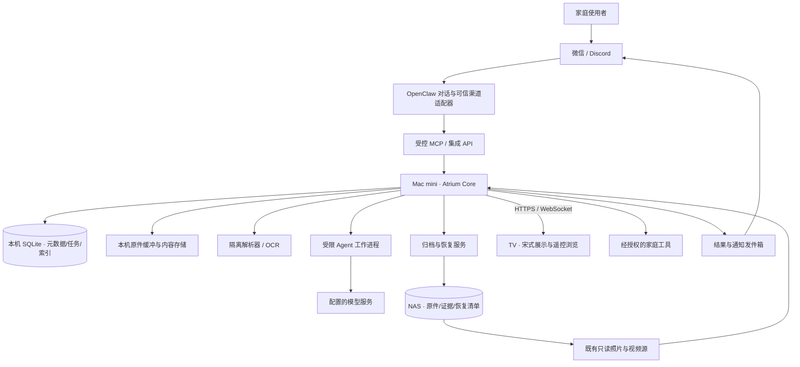

# AtriumOS：家庭 AgentOS 整体系统设计

版本 0.1 · 2026-10-03 · 设计基线，分期实施。任务顺序见[开发计划](../plans/2026-10-03-atriumos-development-plan.md)，实际完成状态和证据以[实施记录](../ops/atriumos-implementation-status.md)为准，本文不把规划能力列作已上线功能。

## 1. 产品定义与边界

AtriumOS 是运行在家庭本地设备上的家庭信息与行动系统。它接收家庭成员通过 IM、文件和设备产生的信息，将资料变为可追溯的家庭知识，在明确的权限内查询、分析、规划和执行任务，并通过 TV 和 IM 呈现结果。

“OS”指共同的身份、数据、任务、工具、展示和恢复基础，而不是改写 macOS、NAS 系统或 Android。第一版服务单个家庭；`household_id` 作为明确的数据作用域，避免将来多家庭时靠名字隔离。人物档案与登录账户不同：报告中出现某个人，不意味着该人获得访问权限。

用户不必先注册一套人物目录或标签。系统从文本、图片及文件识别档案主体、内容和时间，新主体自动建档；信息不足才询问。第一阶段优先全家健康、教育、财务、房屋资料的统一归档与检索，再逐步增加分析和行动。

沿用当前暖纸色、墨色、青瓷强调色、宋式标题、圆润线性图标和遥控交互。长期演进保留影像、今日、房屋等现有功能，不把电视改成聊天控制台。

## 2. 现状审计（代码为准）

基线：`1142c9e`；开发工作树 `codex/atriumos`。现有生产 Core schema 8，OpenClaw 2026.9.8，微信插件 2.4.9 加发送者字段补丁。部署时必须重新检查版本，不将本文作为实时状态。

2026-10-04 只读核对的计算主机为 Apple M4（Mac16,10）、10 个逻辑 CPU、32 GiB 内存、macOS 15.2。后续 OCR/索引/模型队列性能报告以这组硬件和对应软件版本记录；当前尚未完成一万份档案及持续负载验收。

| 层 | 现有能力 | 需要补齐 |
| --- | --- | --- |
| Mac mini / Go Core | HTTPS、SQLite/WAL、集成身份、照片/视频作业、屏幕命令、备份、家庭记录 | 通用档案对象、可信附件接收、解析与理解作业、实体、事实、检索、分析 |
| NAS | 只读照片/视频源；独立家庭记录 JSON 归档 | 原件与证据归档、实体/任务恢复清单、读回校验和恢复演练 |
| OpenClaw + DeepSeek | IM 收发、成员/记录查询和写入、屏幕工具、持久入站去重 | 可信附件桥接、长任务接收/查询、结构化理解、可追溯检索回答 |
| TV / React + Android | 首页、影像、今日、档案、房屋、设置；按阿布展示六条有效喂养记录 | 全家档案、人物/房屋/类型筛选、原件预览、待归属、分析与任务状态 |
| 身份与记录 | 指定成员白名单、修订链、撤回、TV 可见性 | 家庭作用域授权、人物与账户分离、多主体、别名冲突、关联修订 |

`internal/store/jobs.go` 现有照片任务的完成操作没有租约版本约束，不能直接用于多阶段 Agent 工作。现有 Brain turn 是有时限的一轮模型执行，不应承载长 PDF 解析。`family_records` 要求成员和精确时间，不能承担通用档案的全部语义。

## 3. 架构决策

采用模块化单体 Core，加隔离的解析/Agent 工作进程。保持 Go、SQLite、React 主栈，先不引入微服务集群、消息中间件、图数据库或向量数据库。模块通过受控应用接口交互，外部进程不直接写 Core 数据库。

不把家庭事实放在 OpenClaw 会话或模型记忆里。模型是理解和规划执行器；Core 是资料、事实、权限、操作和任务状态的事实来源。未来替换 OpenClaw 或 DeepSeek，不迁移家庭原件、不重建人物 ID。

图中的自动通知是后续能力。第一阶段先接收和查询任务结果，保留现有用户发起会话的回复；不擅自开启定时通知或向新联系人发送消息。

## 4. 四端职责

### Mac mini：家庭控制与计算中枢

本机保存 SQLite、索引、任务日志、暂存原件、预览缓存和配置。Core 同时管理 API、权限、作业租约、事件与恢复。解析输入、像素、文本、文件数量及执行时间有明确限额，可计量缓冲另设预算；原生框架及 codec 内部分配不承诺总进程内存硬上限，按单一 helper 隔离并验证失败清理。解析默认不访问网络；模型工作进程仅能使用分配给任务的片段与受控工具。

不将 SQLite 放到 SMB。原件首先在本机落盘、完成校验，再创建持久接收记录与任务；只有两者都成功才能回复“已保存”。本机容量不足时拒绝新接收，不删除未确认归档的原件来腾空间。

### NAS：长期资料与恢复介质

已有影像目录继续只读。智能档案使用独立根和身份标记，保存原件、版本化提取、事实/实体/关联清单以及备份。原件按内容哈希寻址，用户可读文件名作为元数据保留。

NAS 断开时本机任务可继续，状态为待同步。只有原件、清单写入且读回哈希一致才能标记同步成功。NAS 不能单独代表完整备份：SQLite 备份、配置及恢复清单一起决定恢复范围，密钥另行保管。

### TV：家庭公共信息面

TV 不持有管理员凭据、不运行模型。通过配对屏幕 API 读取公开投影，用现有 WebSocket 命令/通知刷新。复杂输入主要在 IM；TV 提供可用的遥控选择、筛选、分页与原件阅读。

首页保持安静的影像/日期展示；档案页用于主动检索。后台处理完成不抢焦点、不强制切页。沿用默认允许展示家庭记录的用户偏好；具体私密标记优先，撤销时清除投影与缓存；私密子内容会关闭文档未脱敏原件和整页预览，公开分析仅用公开事实重新计算。

### IM：采集、对话与回执

IM 收到的所有聊天不自动成为档案。明确提交的文件、报告、记录和待办进入接收流程；普通问答只读查询。无法确定是否是归档意图时，可保持会话上下文并询问用途，不能将闲聊全量归档。

入站使用 durable inbox/spool 与 Core intake 幂等提交的恢复协议；“模型轮已消费”和“附件已持久保存”分别记录，详见档案设计的两库协议。

附件必须来自当前可信入站消息。适配器生成任务来源、原始消息 ID、附件序号和受限附件引用，模型无法提供任意本机路径替代。微信与 Discord 使用同一 Core 数据；同文件跨渠道复用原件并保留两条来源。

## 5. 模块与所有权

| 模块 | 所有权 | 对外能力 |
| --- | --- | --- |
| Household / Identity | 家庭 ID、集成权限、档案主体、别名、关系与修订 | 授权范围内解析/查询实体，用户纠正 |
| Intake / Originals | 可信消息引用、文件字节、哈希、原件状态 | 接收文本和附件、查询状态、受控预览 |
| Archive Understanding | 解析、证据块、分类、实体/事实提取版本 | 结构化理解建议与提交，不绕过权限 |
| Knowledge / Search | 当前事实、引用、检索索引、关系 | 全家与个人检索、来源回看、历史对比 |
| Analysis | 覆盖范围、确定性计算、解释快照 | 统计、趋势、变化、缺失与出处 |
| Task Runtime | 任务、步骤、租约、尝试、取消、预算 | 可恢复执行、查询、核对、人工澄清 |
| Capability Gateway | 工具契约、权限、风险/确认策略、幂等动作 | 受控调用和执行回执 |
| Presentation | TV 公共投影、IM 回答、导航 | 来源一致、中文文案、展示偏好 |
| Operations | 同步、备份、恢复、诊断、审计 | 状态观测与维护，不泄露原文/凭据 |

领域知识和能力逐步扩展为健康、教育、财务、房屋等模块。首期是一套共享运行时和领域策略，不为每个领域先启动一个自主 Agent。后期只有独立任务确有收益时才加并行执行器。

## 6. 数据层次与契约

1. 来源：真实渠道消息与附件引用，发送者为账户身份，不自动等于档案主体。
2. 原件：不可变字节与哈希；去重不删除来源历史。
3. 提取：可重建的文本/表格/图像区域，每块有稳定定位和解析版本。
4. 实体与事实：人物/房屋/事项及多角色关联，原始值与规范化值分开，时间精度可未知。
5. 分析：明确输入事实版本、覆盖期、算法/解释版本，来源变更则过期。
6. 任务与行动：持久目标、步骤和实际工具回执，不将“模型说完成”当执行证据。

详见[智能综合档案设计](../plans/2026-10-03-family-agentos-archives-design.md)。旧成员、喂养记录与修订链保持不变，新档案提供兼容视图。自动新建主体不自动授予该人登录权限。

档案 blob、logical document、source occurrence 与真实 subject event 分别标识；业务去重不能只靠字节哈希，详细协议见档案设计。旧 family 写入使用事务 outbox 持续投影，不能只回填已有六条。

原件哈希只在同一家庭权限域内用于去重；接口不泄露其他家庭或不可读文档是否已存在。第一版固定一个持久家庭 ID，但所有新表和查询带作用域，不拿默认 ID 代替授权判断。

## 7. 长任务与行动运行时

通用任务的生命周期为：`queued → running → succeeded`；也可到 `waiting_input`、`retry_wait`、`failed`、`cancelled`。重新开始不是重写原任务历史，尝试与阶段事件持久保存。

- 领取任务采用事务和租约令牌，租约超时可以被新工作进程领取。旧工作进程不能在失去租约后提交成功、失败或重试状态。
- 独立 task_id、attempt_id、operation_id。任务身份不由模型随意生成，重复请求使用接入层稳定键；键相同而参数不同返回冲突。
- 取消停止后续调度；已开始的外部动作标为待核对，不能把取消解释成外部动作已撤销。
- 只自动重试纯读取、确定性解析、幂等提交。结果不明的支付、发送或设备动作先查询回执，不自动重发。
- 步骤结果与下一步 outbox 入队在同一数据库事务提交。进程崩溃后重放事件不能重复提交事实。
- 开始、续租和提交均检查权限代次。撤销权限后暂停或终结关联作业，缓存与 TV 结果同步失效。
- 资料缺页、人物冲突等进入 `waiting_input`；针对性澄清归属于原任务，后续消息恢复该任务而非另建重复档案。

第一阶段的通用任务队列只用于档案。定时执行、主动提醒、家庭设备控制、外部交易等后续接入，不能因存在队列就默认已获授权。

## 8. 模型与解析策略

保留当前 DeepSeek 主模型。使用结构化 schema、明确来源片段和工具边界；分类、名称候选和解释由模型完成，金额加总、日期区间、计量换算和趋势由代码计算。

首批格式为文本、JPEG/PNG/WebP、PDF、DOCX、XLSX、CSV。先保存原件再解析；不支持的格式保留原件和明确状态。macOS Vision / PDFKit 是本机 OCR / PDF 解析候选，需在实际图片与扫描件上验证中文、旋转页和表格能力，不能把 API 存在当成提取质量保证。[Apple Vision](https://developer.apple.com/documentation/vision/recognizing-text-in-images)、[PDFKit](https://developer.apple.com/documentation/pdfkit)

结构化提取必须附 page/block/sheet/cell 等来源定位，找不到来源的数字不能成为正式事实。模型置信度只做排序提示；自动归属使用可检查的主体角色及身份一致性规则。

索引先采用 SQLite FTS5 加受控过滤。中文两字姓名/短词需专门覆盖：trigram 对短于三个字符的全文词有局限，不能仅靠该 tokenizer 宣称中文搜索完整；短词使用实体别名/有界子串路径，长查询使用索引。[SQLite FTS5](https://www.sqlite.org/fts5.html#the_trigram_tokenizer)

## 9. API 与兼容策略

沿用 `/api/v1` 和现有 envelope、鉴权、错误代码、分页与 request_id 习惯。新档案单独命名，不让旧 `family/records` 接口承载任意文件。

| 接口族（计划） | 调用者 | 行为 |
| --- | --- | --- |
| `/integrations/archives/intakes` | 可信接入适配器 | 接收单槽有界文本/字节，返回自有 receipt/task ID；有 read 权限才附文档引用 |
| `/integrations/archives/intakes/lookup` | 原接入 principal | 用来源 metadata 查询已提交回执，无须重传内容 |
| `/integrations/archives/tasks/{id}` | 获授权 IM / Agent | 查询阶段、结果和需要用户补充的问题 |
| `/integrations/archives/search` | IM / Agent | 返回片段、实体、类别、日期与原件引用 |
| `/integrations/archives/documents/{id}` | IM / Agent | 当前提取、事实、来源定位、历史版本 |
| `/integrations/archives/entities` | IM / Agent | 查询/建议主体；创建通过受控提交流程完成 |
| `/archives/*` | 配对 TV | 只读公开投影，权限收紧后不可继续读原件 |
| `/admin/archives/*` | 管理员 | 配置、重新解析、恢复、审计与故障诊断 |

具体 HTTP schema 在对应实现任务中随测试提交。允许的工具名称、参数、输出上限同步修改 MCP、Brain inventory、OpenClaw manifest；运行时不得无声放开未知工具。

## 10. 视觉与信息架构

一级导航：**首页 · 影像 · 今日 · 档案 · 房屋 · 设置**。沿用 `web/src/ui/TopNav.tsx`、`RemoteButton`、现有 design tokens 和布局尺寸。已有主界面风格是权威参考，不另做新配色主题。

档案首页为全家视角，主体标题“家庭档案”。左侧为全家/人物/房屋和领域筛选，右侧为搜索结果、时间线与摘要；详情展示原件、字段和出处；待处理入口显示进行中、待归属、待补页。人物页才使用“某某的档案”。数据不足时不给空卡片填假数字。

统计卡写明“已归档范围”“最近一次”或“本月合计”，金额/奶量不能把最新值显示成总量。报告日期与接收日期分开。中文指标名称映射保留原名；时间轴同日多次事件显示时间。

遥控操作遵循上/下移动、左回筛选、右入内容、确认打开、返回恢复焦点。异步刷新保持阅读位置；任务结果不抢焦点。Chrome 66 为已知老 TV 兼容基线，OnePlus 是便利测试终端，不替代实际电视兼容验收。

## 11. 权限、配置与隐私

延续当前管理员、集成身份、配对屏幕三种调用身份。新增 `archive.read`、`archive.ingest`、`archive.organize`、`archive.analyze` 等细分权限及明确 household_ids；worker 提交另有内部能力，不把创建人物等同管理员权限。

默认 TV 可见来自用户现有授权，落为持久家庭偏好；单文档/事实私密要求优先。重新解析和去重不能把私密资料恢复公开。原件中的账号、签名等属于文档内容；展示策略需要统一投影，不在各页面临时决定。

模型只能读取任务/查询授权资料。文件正文、二维码、链接或元数据不能扩大工具权限；原件不作为可执行程序。日志只记录任务 ID、错误码、字节数和耗时，不写医疗原文、完整身份号码或 token。主服务配置与模型密钥不进入模型参数。

初始资源预算为设计值：单附件 32 MiB、单 PDF 100 页、单次提取文本 2 MiB、解析并行 2、理解并行 1。超限保留明确接收结果/错误，不截断后谎称完整解析。部署前用 Mac mini 负载与真实样本调整，预算可以配置且变更有审计。

## 12. 可靠性、备份与运维

| 故障 | 用户可见状态 | 恢复要求 |
| --- | --- | --- |
| 模型不可用 | 原件已保存，等待理解 | 有界重试，不丢原件，不伪造分类 |
| NAS 离线 | 本机已保存，NAS 待同步 | 目录身份恢复后继续，绝不写入错误本地挂载点 |
| Core 重启 | 暂时离线，恢复后任务继续 | 已提交接收/任务不丢失，租约过期回收 |
| 解析崩溃/恶劣文件 | 已保存，解析失败或不支持 | 进程隔离，其他作业和 TV 正常 |
| 部分附件失败 | 明确逐附件状态 | 不将整条消息标成全部成功 |
| 用户撤回/改归属 | 当前视图变化，旧版可审计 | 索引、汇总、TV 投影失效或重建 |
| IM 回复失败 | Core 结果仍可查询 | 后续发件箱重试遵守渠道幂等能力，未知投递不盲目重发 |

运行目标而非当前 SLA：元数据接收 P95 < 2 秒（文件传输另计），普通索引查询 P95 < 500 ms/一万份样本；重启恢复调度 < 60 秒。OCR/理解按页数和模型延迟观测，不承诺固定秒数。暴露队列长度、最旧等待时间、失败原因分布、NAS 未同步数量、原件空间与模型用量。

已确认本机落盘的接收在进程重启后不丢；整机磁盘损坏的 RPO 取决于最近同步/备份，不宣称零丢失。恢复演练必须在新目录完成：校验数据库、原件哈希、实体关系、当前事实、权限与索引可重建，再由维护操作切换。NAS 恢复不复用旧 IM 投递状态去执行历史动作。

## 13. 演进阶段与完成定义

- **A0 设计与基线**：本设计、档案契约、开发计划、验收矩阵及代码基线。
- **A1 智能综合档案**：文本/图片/文件接收，原件保存，自动分类归属，综合检索，TV 全家档案，基本统计，NAS 可恢复。所有部分验收后才称第一阶段交付。
- **A2 家庭分析与计划**：跨记录趋势、教育与房屋时间线、家庭资料完整性、用户发起计划，结论有来源、行动有授权。
- **A3 持久 Agent 任务**：可审阅任务计划、澄清恢复、权限和预算、已授权提醒与事件触发、执行回执。
- **A4 家庭能力生态**：逐项增加日历、设备、购物/维修等连接器，以能力契约接入，不预设接入设备或供应商。

本轮先完整设计 A0–A4，详细可执行计划覆盖 A1，并实际执行该计划。A2–A4 是后续路线，不把未来所有外部连接器当成当前已实现，也不以写完文档代替 A1 交付。

## 14. 核心决策记录

- ADR-01：保留模块化单体与现有栈，避免平台基础设施先于家庭体验。
- ADR-02：原件/证据/事实/分析分层，模型输出必须可追溯。
- ADR-03：人物实体自动发现，权限身份人工/系统授权，两者不混合。
- ADR-04：采用持久任务租约及提交校验；一轮对话不等于业务事务。
- ADR-05：本机先保存，NAS 异步确认；照片源继续只读。
- ADR-06：分析使用可复算代码，模型解释保留引用与覆盖边界。
- ADR-07：沿用 TV 设计和旧路由，增量替换档案内容，旧数据兼容。
- ADR-08：第一版先做通用档案，健康、教育、财务、房屋统一检索；专题 Agent 后续扩展。

## 15. 验收证据索引

实现记录放在 `docs/ops/atriumos-implementation-status.md`：每项写测试命令、退出状态、样本类型、实际链路和未通过项。生产私人资料与原始日志保留本机私有目录，不进入 Git。发布前按开发计划逐项核对，不以窄测试或成功截图证明全部系统完成。
