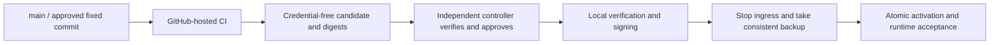

# Atrium build, release and deployment

[中文](deployment-release.md) · [Documentation](../README.md) · [Project overview](../../README.en.md)

Updated: 2026-10-13. This guide is for maintainers. The deployed baseline is fixed commit `c06c6a591e9a33c6a93bc0def15d3e29061f9d07`; updating the main branch does not automatically change the running version.

## 1. Release boundary and current implementation

The public repository uses **GitHub-hosted runners for builds**. An **independent controlled process deploys** the result. **Signing certificates and private keys stay on the local machine**. Build environments receive source, pinned dependencies and synthetic fixtures; only deployment environments can access runtime configuration and household data.



Complete hosted candidates, the controller and automated promotion in this diagram are the agreed future architecture. The repository currently has CI, a complete local builder and manual deployment tools; the full automated release chain is not implemented.

| Capability | Implemented now | Future connection |
| --- | --- | --- |
| Go/Web/Shell checks | `.github/workflows/ci.yml`, GitHub-hosted Linux runners | Pin tools and configure required main-branch checks |
| macOS Go binaries | CI cross-compiles arm64/amd64 and uploads Actions artifacts | Durable release assets and provenance for approved versions |
| Complete archive candidate | `deploy/build-release.sh`, Darwin/arm64 only | GitHub-hosted macOS arm64 job with prepared trusted runtimes |
| Deployment | Maintainer runs verified steps locally | Independent controller, provenance checks, serial approval and local promotion |
| Signing | Existing local certificate and keychain | Reuse the same identity; stop automated promotion if unavailable |
| Android APK | Independent build in `android-tv/` | Separate build job and local production signing; current CI does not produce APKs |

Current CI does not create GitHub Releases, invoke the complete package builder, sign or deploy. It also does not replace real TV, external IM, native parser or whole-system recovery acceptance.

## 2. Branches, versions and merging

`main` is the integrated source baseline. Develop on short-lived branches and merge through a PR, review and CI. Release records identify a full commit SHA rather than a moving branch. A merge commit preserves the existing deployed version's history and its connection to deployment evidence.

Future version tags should point to accepted commits on `main`. The controller must verify the full resolved SHA, source repository, build workflow/run, artifact digest and approval record. A tag string, filename or abbreviated commit is insufficient provenance.

Main-branch protection was not configured at the time of this integration. Required PR review and CI are currently maintenance procedure. Configure rulesets/branch protection and required checks later; this guide does not claim those GitHub restrictions are already enabled.

## 3. What existing GitHub Actions do

[`ci.yml`](../../.github/workflows/ci.yml) runs on pushes to all branches, pull requests and manual dispatch. It defaults to `contents: read`, Go 1.25 / Node 24, with all four job types on `ubuntu-latest`:

| Job | Checks or output |
| --- | --- |
| Go | gofmt, vet, golangci-lint, `go test -race ./...`, `go build ./...` |
| Web | `npm ci`, lint, tests and build including type checks; `web-dist` retained for 7 days |
| Shell scripts | ShellCheck for every tracked `.sh` file |
| Release binaries | Waits for Go/Web, downloads the Web bundle, runs `make release`; both macOS architectures of Core/MCP/Brain retained for 14 days |

`Release binaries` currently **does not depend on the Shell job**. Promotion must require the entire workflow to succeed, including Shell, rather than only the binary job. `make release` omits the spool reader, native helper/codecs, channel patches and runtime fingerprints. Its artifacts are not a complete archive release package.

For development, use `make check` (Go vet/lint/test/build) and run `npm run lint`, `npm test`, `npm run build` inside `web/`. CI additionally requires race tests and ShellCheck. Native parser or channel changes also require their synthetic and actual integration acceptance.

## 4. Complete candidates: local builder available, hosted job pending

The complete package requires macOS Frameworks and an arm64 native helper; cross-compiling Go on Linux cannot replace these. A future hosted job should explicitly select a macOS arm64 runner and check `uname -s` / `uname -m`. Consult [GitHub-hosted runner documentation](https://docs.github.com/en/actions/reference/runners/github-hosted-runners) for available labels.

The builder exports a fixed commit through `git archive`, excluding uncommitted workspace changes. The output must be an absolute, nonexistent path; existing directories, files and dangling links are rejected. Failed builds leave their owned output for inspection; retry with a new destination.

Run the following from the repository root on a trusted Darwin/arm64 build machine. Install and verify dependencies first, then replace the example absolute paths and full SHA:

```sh
export ATRIUM_RELEASE_NODE=/absolute/trusted/node/bin/node
export ATRIUM_RELEASE_OPENCLAW=/absolute/trusted/openclaw
export ATRIUM_RELEASE_PROVIDER=/absolute/trusted/deepseek-provider
make release-package RELEASE_DIR=/absolute/new/atrium-candidate RELEASE_SHA=FULL_COMMIT_SHA
python3 /absolute/new/atrium-candidate/scripts/manifest.py /absolute/new/atrium-candidate --verify
```

`FULL_COMMIT_SHA` is a placeholder; replace it before execution. The builder currently requires Node **24.21.0**, OpenClaw/provider **2026.9.8**, the provider's matching OpenClaw link and full bounded tree fingerprints. It does not install dependencies or accept Codex runtime paths. Trusted installation trees must remain unchanged during fingerprinting and construction.

The complete package contains freshly built Web assets embedded in Core; `atrium`, `home-mcp`, `atrium-brain-host`, `atrium-spool-read`; OpenClaw plugin/worker resources; channel patches and pins; the macOS helper; three codecs with pinned bytes and licenses; migrations; manifest and schema guard. Node/OpenClaw/provider themselves remain separate trusted runtime bindings and **are not bundled by the builder**.

`runtime-pins.json` contains builder-side absolute paths and runtime fingerprints, not production configuration. The deployment side must verify local trusted installations' versions, content fingerprints and peer bindings, then record local paths. Do not adopt cloud absolute paths directly or silently change candidate provenance. The future promoter should preserve the original candidate digest and record local bindings and the signed manifest as a derived output. That promoter does not yet exist.

Current `runtime-pins.py` generates records without a `--verify` or rebinding mode. `manifest.py --verify` checks only packaged files, and the Go worker does not read that pins file. Verify external runtimes separately against trusted installation provenance and expected file digests; matching versions are insufficient. The two fingerprint algorithms differ, and symlink path changes can alter digests. Do not mechanically equate cloud and local fingerprints or treat editing pins and regenerating a manifest as proof of trust.

Local bindings are configured in protected `config.yaml`:

| Configuration field | Target |
| --- | --- |
| `archives.native_helper_path` | Final signed package's `native/helper` |
| `archives.node_path` | Trusted local Node executable |
| `archives.openclaw_path` | Trusted local OpenClaw CLI entry file, rather than the package directory used by the build variable |
| `archives.worker_plugin_path` | Final package's `openclaw-plugin/archive-worker-plugin` directory |
| `archives.provider_path` | Trusted local provider package, whose peer link targets the above OpenClaw installation |

Preserve original candidate tar/pins/digests. Record local paths, external installation provenance and file digests, the calculated worker configuration fingerprint and final signed manifest in a protected release ledger. There is no standardized cross-machine rebinding ledger or automatic equivalence verifier today. Stop promotion on unexplained provenance or digest differences rather than skipping checks. These fields describe binding targets, not an installed automated rebinding process.

## 5. Candidate transfer and independent controller

A future release job should create a tar archive of the candidate before uploading the tar, SHA-256 and build provenance. This preserves `.atrium-release-owned` and executable permissions; direct directory upload excludes hidden files by default and changes permissions. See [upload-artifact limitations](https://github.com/actions/upload-artifact#limitations). Current binary artifacts have no complete package manifest.

The controller should fetch artifacts using authorized GitHub APIs and verify the trusted repository, fixed workflow, approved main/tag SHA, successful overall run and independently obtained digest. An arbitrary PR artifact cannot authorize deployment. Before extraction, reject traversal, absolute paths and links. Extract into a new protected staging directory, verify the full file manifest, then hand it to local promotion.

The controller may run in a separate private project or isolated runner. It must not access household data, production configuration, model credentials or the local signing key, or check out arbitrary PR code in a privileged stage. Do not register the production Mac as a public repository's PR self-hosted runner. Environment approvals can contribute to release authorization but do not provide machine isolation. See [GitHub runner security guidance](https://docs.github.com/en/actions/reference/security/secure-use#hardening-for-self-hosted-runners) and [deployment controls](https://docs.github.com/en/actions/how-tos/deploy/configure-and-manage-deployments/control-deployments).

Allow only one local promotion at a time. Automation credentials should retrieve approved candidates, without giving public CI login access to production.

## 6. Local signing and credential boundary

Reuse the existing **Atrium Core Signing** identity, with Core identifier **`io.atrium.core`**, to preserve macOS NAS/TCC authorization. The signing keychain, private key and protected password file stay local and out of GitHub Secrets, build machines, artifacts, logs and source control.

`deploy/sign-macos.sh` initializes a new identity when the keychain is absent, so it cannot be an unconditional automated promotion step. Check the existing keychain, private-key/certificate identity and established designated requirement first. Stop on absence or mismatch and have the maintainer recover the existing identity; automated release must not silently create a replacement certificate.

Sign only `bin/*` and `native/helper`, retaining the existing identifiers:

| File | Identifier |
| --- | --- |
| `bin/atrium` | `io.atrium.core` |
| `bin/home-mcp` | `io.atrium.home-mcp` |
| `bin/atrium-brain-host` | `io.atrium.brain-host` |
| `bin/atrium-spool-read` | `io.atrium.spool-read` |
| `native/helper` | `io.atrium.archive-parser` |

Existing `sign-macos.sh` handles only the Core identity; do not apply it indiscriminately to the other files. Never use `codesign --deep` or re-sign codec dylibs, which would invalidate their pinned digests. Sign a separate staging copy while preserving the original candidate unchanged. Signing changes executable bytes and the actual worker fingerprint. After strict signature verification, regenerate the final manifest:

```sh
python3 /absolute/staged/package/scripts/manifest.py /absolute/staged/package
python3 /absolute/staged/package/scripts/manifest.py /absolute/staged/package --verify
```

Then relocate the complete package and parse synthetic PDF/PNG/JPEG/WebP under a sanitized environment. Verify missing codecs return `parser_unavailable` with incomplete coverage. Keep the final signed package immutable after verification, and record both original candidate and signed package digests.

Core supports `serve --provider-env-file /protected/service.env`; launchd arguments contain only that path. The file must be service-user-owned, 0600, regular, with one hard link and exactly one unquoted `DEEPSEEK_API_KEY=<value>` line. Never put the real value in commands, plist files or output.

## 7. Backup, activation and runtime acceptance

Record the current running SHA, schema history, channel versions, runtime fingerprints and signing identity. Rehearse compatibility in an isolated directory first. Preserve screen pairing, member/source allowlists, IM identities and tool authorization.

For the final backup, stop OpenClaw ingress and Core writes, obtain consistent SQLite backups while all related databases are quiescent, and preserve archive originals, configuration, TLS/credentials, Brain inbox/ledger/spool, channel state and previous programs. Do not copy only a live SQLite main file while ignoring WAL. Rebuildable photo caches may be excluded; retain all pending IM and new material. Restrict access to backups and evidence, and preserve NAS mounts, automatic login and keychain settings.

| Upgrade type | Sequence |
| --- | --- |
| First archive upgrade, such as schema 8→17 | Disable archives; rehearse separately; back up; run candidate `maintenance schema` and `maintenance backfill`; compare historical rows, stable legacy event IDs, current projections, outbox and search catch-up before enabling |
| Routine hotfix already on schema 17 | Verify target migration history and runtime compatibility; back up and replace programs; do not mechanically require first-upgrade backfill for every hotfix |

For the first upgrade, use the candidate Core CLI with the prepared production data configuration. `maintenance schema` validates and reports the current and latest supported schema without applying migrations. It uses a normal WAL connection, rather than the external read-only guard. `maintenance backfill` applies pending migrations, then projects legacy records, drains the outbox and catches up search. Complete the preceding ingress stop, backup and rehearsal first:

```sh
/absolute/staged/package/bin/atrium maintenance schema --config /protected/config.yaml
/absolute/staged/package/bin/atrium maintenance backfill --config /protected/config.yaml
```

Backfill can be interrupted and repeated; successful counts do not demonstrate model accuracy. Independently compare every old record, correction history, visibility and original digest before activation. Generate the tool inventory from the same candidate Brain/MCP binaries and preserve existing principal permissions.

After signatures, manifest and local paths are verified, atomically activate stable binaries, configuration and the immutable package reference using the existing local service layout, then start Core/OpenClaw. There is no callable one-command controlled deployment tool today. The controller should implement these steps as a stateful, stoppable, serial promoter.

Minimum runtime acceptance includes:

- Successful `/health/live` and `/health/ready` reporting the target full SHA, and healthy launchd services.
- Production database integrity/FK checks, retention of all previous rows/history, and preserved pending ingress state.
- Synthetic parsing/model calls in the actual service environment, with the worker using target resources and fingerprints.
- Healthy channels plus separate tests using new messages actually sent by the user on Weixin/Discord. A connected probe does not demonstrate receipt, persistence and retrieval.
- Actual TV pages, pairing, newest-first records, day/week/month milk trends, queries and private-content revocation. ADB connectivity does not demonstrate correct display.

Keep detailed production evidence in protected local storage. Publish only redacted counts, versions and outcomes; never upload real documents, message receipt identifiers, screenshots, databases or raw logs.

## 8. Rollback and recovery

Stop writers and take a **new post-upgrade snapshot** before rollback, preserving new records, originals and Brain queues. Never overwrite the only current database with an old backup: it would lose material received after upgrade.

Before running an old binary, use independently verified target-package migration files for a read-only compatibility check. Replace the placeholder paths and integer before executing:

```sh
python3 /absolute/verified/package/scripts/schema-guard.py /protected/current.db /absolute/verified/target/migrations TARGET_MAX_SCHEMA
```

The guard checks an exact migration name/version prefix; it does not migrate, downgrade or launch a program. A schema-8-era binary must reject a schema-17 database. Keep writers stopped between the check and old-binary invocation. On rejection, retain compatible current programs/data or restore into a separate directory, verify and reconcile new data rather than forcing a downgrade. There is no verified lossless cross-schema downgrade or automatic new-data reconciliation tool today. Without a separate recovery plan, stop rollback and retain compatible current programs and the new snapshot.

Legacy family-record synchronization, local operational backups and T16 complete NAS archive recovery are separate capabilities. T16 immutable snapshots, full archive-graph recovery and recovery closure have not been delivered; this procedure does not mark them complete.

## 9. Release records and next steps

Record source SHA, workflow/run, original candidate digest, final signed manifest, runtime bindings, backup point, schema decision, runtime acceptance and approver for each release. Public records are redacted; detailed evidence stays local.

Future automation sequence: pin CI tools/Actions provenance and main-branch checks → hosted macOS complete candidate builds → durable artifacts and provenance verification → independent controller → signing/promotion with the existing local identity → end-to-end deployment rehearsal. Build Android production packages separately and sign with a long-lived local key; current debug APKs are not public production releases.

Remaining family AgentOS work includes full T15 model/system acceptance, T16 NAS recovery, T17 one-hour sustained ingress and 10,000-document performance, and T18 final audit. Merging into main or passing CI does not complete those gates. See [implementation status](atriumos-implementation-status.md), [historical deployment evidence](atriumos-runbook.md) and [complete package tools](../../deploy/release/README.md).
