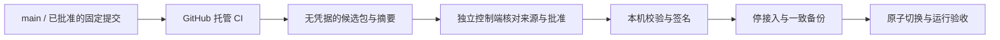

# Atrium 构建、发布与部署

[English](deployment-release.en.md) · [文档导航](../README.md) · [项目介绍](../../README.md)

更新：2026-10-13。本流程面向维护者。线上部署基线为固定提交 `c06c6a591e9a33c6a93bc0def15d3e29061f9d07`；主分支更新不会自动改变运行版本。

## 1. 发布边界与现状

公开仓库使用 **GitHub 托管 runner 构建**；**独立受控流程负责部署**；**签名证书与私钥留在本机**。构建环境只接触源码、锁定依赖和合成测试资料，部署环境才能接触运行配置与家庭数据。



图中的完整候选构建、控制端和自动晋级是约定的后续架构；当前仓库已有 CI、完整本机构建器和手动部署工具，尚未实现完整自动发布链路。

| 能力 | 当前实现 | 后续接入 |
| --- | --- | --- |
| Go/Web/Shell 校验 | `.github/workflows/ci.yml`，GitHub 托管 Linux runner | 固定工具版本，配置主分支必需检查 |
| macOS Go 二进制 | CI 交叉编译 arm64/amd64，上传 Actions artifacts | 经批准版本的长期 release assets 与来源记录 |
| 完整档案候选包 | `deploy/build-release.sh`，仅 Darwin/arm64 | GitHub 托管 macOS arm64 job，准备可信运行时后调用构建器 |
| 部署 | 维护者在本机执行已验证的发布步骤 | 独立控制端、来源校验、串行批准与本机晋级 |
| 签名 | 既有本机证书与 keychain | 复用同一身份；缺失时停止自动晋级 |
| Android APK | `android-tv/` 独立构建 | 独立构建任务与本机正式签名，当前 CI 不生成 APK |

当前 CI 不创建 GitHub Release、不调用完整包构建器、不签名、不部署。它也没有替代真实 TV、外部 IM、原生解析器和整机恢复验收。

## 2. 分支、版本与合并

`main` 是已整合的源码基线。开发使用短期分支，通过 PR、审查和 CI 后合并；发布记录固定完整提交 SHA，而不是随时移动的分支名。既有线上版本通过 merge commit 保留历史，便于与部署证据对应。

后续发布使用指向已验收 `main` 提交的版本 tag。控制端必须核实 tag 解析出的完整 SHA、来源仓库、构建 workflow/run、产物摘要和批准记录。不要仅凭 tag 文本、文件名或提交短 SHA 信任产物。

本次整合时主分支尚未配置保护规则；“要求 PR 审查和 CI”目前是维护流程约定。后续应配置 ruleset/branch protection 和必需检查，不将文档约定误写为已启用的 GitHub 限制。

## 3. 现有 GitHub Actions 做什么

[`ci.yml`](../../.github/workflows/ci.yml) 对所有分支 push、PR 和手动触发运行，默认 `contents: read`，Go 1.25 / Node 24，四类 job 均使用 `ubuntu-latest`：

| Job | 检查或输出 |
| --- | --- |
| Go | gofmt、vet、golangci-lint、`go test -race ./...`、`go build ./...` |
| Web | `npm ci`、lint、测试、含类型检查的 build；`web-dist` 保留 7 天 |
| Shell scripts | 对仓库所有已跟踪 `.sh` 运行 ShellCheck |
| Release binaries | 等待 Go/Web，下载 Web bundle 后 `make release`；Core/MCP/Brain 两种 macOS 架构产物保留 14 天 |

`Release binaries` 当前 **没有依赖 Shell job**。晋级必须检查整次 workflow 成功，包括 Shell，不能只看二进制 job 成功。`make release` 不包含 spool reader、原生 helper/codecs、渠道补丁和运行时指纹，不能将其产物直接当完整档案发布包。

开发检查可使用 `make check`（Go vet/lint/test/build）和 `web/` 内的 `npm run lint`、`npm test`、`npm run build`。CI 额外要求 race 与 ShellCheck；更改原生解析或渠道时，还需执行相应的合成和实际链路验收。

## 4. 完整候选包：本机可执行，托管构建待接入

完整包需要 macOS Frameworks 与 arm64 原生 helper，Linux 上交叉编译 Go 不足以替代它。未来托管 job 应明确选择 macOS arm64 runner，并检查 `uname -s` / `uname -m`；可用标签以 [GitHub 托管 runner 文档](https://docs.github.com/en/actions/reference/runners/github-hosted-runners)为准。

构建器从固定提交 `git archive` 导出源码，忽略工作区未提交改动。输出必须是绝对路径且尚不存在；现存目录、文件和悬空链接都拒绝。失败后的 owned 目录留作检查，重试选择新目录。

以下命令在可信 Darwin/arm64 构建机、仓库根目录执行。先安装并核实依赖，再替换示例绝对路径和完整 SHA：

```sh
export ATRIUM_RELEASE_NODE=/absolute/trusted/node/bin/node
export ATRIUM_RELEASE_OPENCLAW=/absolute/trusted/openclaw
export ATRIUM_RELEASE_PROVIDER=/absolute/trusted/deepseek-provider
make release-package RELEASE_DIR=/absolute/new/atrium-candidate RELEASE_SHA=FULL_COMMIT_SHA
python3 /absolute/new/atrium-candidate/scripts/manifest.py /absolute/new/atrium-candidate --verify
```

`FULL_COMMIT_SHA` 是占位符，执行前替换为实际 SHA。构建器目前固定 Node **24.21.0**、OpenClaw/provider **2026.9.8**，核对 provider 的 OpenClaw 链接和完整有界目录指纹。它不会安装依赖，不接受 Codex runtime 路径；可信安装树在指纹检查和构建期间必须保持不变。

完整包包括：新构建并嵌入 Core 的 Web、`atrium` / `home-mcp` / `atrium-brain-host` / `atrium-spool-read`、OpenClaw 插件与 worker、渠道补丁与 pins、macOS helper、三个固定字节的 codec 及许可、migrations、清单与 schema guard。Node/OpenClaw/provider 本体是独立的可信运行时绑定，**没有被构建器装入包内**。

`runtime-pins.json` 含构建机绝对路径与运行时指纹；它不是生产配置。部署端要核对本机可信安装的版本、内容指纹和 peer 绑定，并记录本机路径。不得直接采用云端绝对路径，或在未记录来源的情况下修改候选清单。未来晋级器应保留原始候选摘要，把本机绑定和最终签名清单记录为派生产物；该晋级器尚未实现。

当前 `runtime-pins.py` 生成记录，没有 `--verify` 或重绑定功能；`manifest.py --verify` 只验证包内文件，Go worker 不读取这份 pins 文件。外部运行时须另行依据可信安装来源和预期文件摘要核验；版本号相同不够。两套指纹算法不同，符号链接路径变化也可能改变摘要，不能将云端与本机的指纹机械等同，或仅修改 pins 并重算清单作为可信证明。

当前本机配置绑定在受保护的 `config.yaml`：

| 配置字段 | 绑定目标 |
| --- | --- |
| `archives.native_helper_path` | 最终签名包的 `native/helper` |
| `archives.node_path` | 本机可信 Node 可执行文件 |
| `archives.openclaw_path` | 本机可信 OpenClaw CLI 入口文件，区别于构建变量中的包目录 |
| `archives.worker_plugin_path` | 最终包的 `openclaw-plugin/archive-worker-plugin` 目录 |
| `archives.provider_path` | 本机可信 provider 包目录，peer 链接指向上述 OpenClaw 安装 |

原候选 tar/pins/摘要保持原样；本机路径、外部安装来源与文件摘要、计算出的 worker configuration fingerprint 和最终签名包清单，记录在受保护的发布台账。当前没有统一的跨机重绑定台账格式或自动等价核验器；出现来源或摘要无法解释的差异时停止晋级，而不是跳过检查。以上配置只描述绑定目标，不构成已部署的自动重绑定流程。

## 5. 候选传输与独立控制端

未来的 release job 先把候选目录打成 tar 包，再上传 tar、SHA-256 和构建来源记录。这样保留 `.atrium-release-owned` 与可执行权限；直接上传目录默认会遗漏隐藏文件并改变权限。见 [upload-artifact 限制](https://github.com/actions/upload-artifact#limitations)。当前 CI 的普通二进制 artifact 不具备完整包清单。

控制端应使用有权限的 GitHub API 获取产物，核对可信仓库、固定 workflow、已批准的 main/tag SHA、整次运行成功及独立取得的摘要。来自任意 PR 的 artifact 不能成为部署授权。解包前拒绝路径穿越、绝对路径和链接；解包到新的受保护暂存目录，验证全部文件清单，再交给本机晋级。

控制端可在独立私有项目或隔离 runner 上运行；不能读取家庭数据、生产配置、模型凭据和本机签名私钥，也不能在特权阶段 checkout 任意 PR。生产 Mac 不注册为公开仓库的 PR self-hosted runner。Environment 审批可作为发布批准的一环，但不提供机器隔离。参见 [GitHub runner 安全说明](https://docs.github.com/en/actions/reference/security/secure-use#hardening-for-self-hosted-runners)和[部署控制文档](https://docs.github.com/en/actions/how-tos/deploy/configure-and-manage-deployments/control-deployments)。

一次只允许一个本机晋级作业。自动化的凭据仅具备获取已批准候选的权限，不赋予 public CI 登录生产机的权限。

## 6. 本机签名与密钥边界

复用既有 **Atrium Core Signing** 身份，Core identifier 固定 **`io.atrium.core`**，以保持 macOS NAS/TCC 授权。签名 keychain、私钥与受保护密码文件仅留在本机，不进入 GitHub Secrets、构建机、产物、日志或仓库。

`deploy/sign-macos.sh` 在 keychain 不存在时会初始化新身份，因此不能无条件作为自动晋级步骤。晋级前检查既有 keychain、私钥/证书身份与既有 designated requirement；缺失或不一致时停止，由维护者恢复既有身份。自动发布不得静默创建替代证书。

仅签 `bin/*` 和 `native/helper`；各 identifier 保持既有值：

| 文件 | Identifier |
| --- | --- |
| `bin/atrium` | `io.atrium.core` |
| `bin/home-mcp` | `io.atrium.home-mcp` |
| `bin/atrium-brain-host` | `io.atrium.brain-host` |
| `bin/atrium-spool-read` | `io.atrium.spool-read` |
| `native/helper` | `io.atrium.archive-parser` |

现有 `sign-macos.sh` 只处理 Core 身份，不能用它无差别签其余文件。禁止 `codesign --deep` 或重签 codec dylib，否则破坏其固定摘要。在独立暂存副本中签名，保留原候选不可变。签名改变可执行字节和实际 worker 指纹；严格签名验证通过后重新生成最终清单：

```sh
python3 /absolute/staged/package/scripts/manifest.py /absolute/staged/package
python3 /absolute/staged/package/scripts/manifest.py /absolute/staged/package --verify
```

随后搬移完整包，以净化环境解析合成 PDF/PNG/JPEG/WebP，并验证缺 codec 返回 `parser_unavailable` 且非 complete。最终签名包与清单验证后保持不可变；验收记录同时保存原候选和最终签名包摘要。

Core 可使用 `serve --provider-env-file /protected/service.env`，launchd 参数只保存文件路径。文件须为服务用户所有、0600、普通单硬链接文件，只含一行未加引号的 `DEEPSEEK_API_KEY=<value>`；不要把真实值放入命令、plist 或输出。

## 7. 备份、切换与运行验收

部署前记录当前运行 SHA、schema 历史、渠道版本、运行时指纹和签名身份，先用隔离目录演练兼容性。保护当前屏幕配对、成员/来源 allowlist、IM 身份与工具授权。

正式备份先停止 OpenClaw 接入与 Core 写入，取得跨库静止的一致 SQLite 备份，并备份档案原件、配置、TLS/凭据、Brain inbox/ledger/spool、渠道状态与旧程序。不要只复制正在写入的 SQLite 主文件而忽略 WAL。可排除可重建照片缓存；保留全部待处理 IM 与新资料。备份目录与证据须限制访问。保持 NAS 挂载、自动登录和 keychain 配置。

| 升级类型 | 顺序 |
| --- | --- |
| 首次档案升级，例如 schema 8→17 | 先关闭档案功能；隔离演练；备份；使用候选的 `maintenance schema` 与 `maintenance backfill`；核对历史行、稳定旧事件 ID、当前投影、outbox 和检索追平后启用 |
| 已在 schema 17 的普通补丁 | 核对目标 migration 历史与运行时兼容；备份并更换程序；不把首次回填步骤机械重做为所有补丁的前提 |

首次升级使用候选 Core CLI，配置指向已准备的生产数据；`maintenance schema` 校验并报告当前 schema 与本版本最新 schema，不执行迁移；它使用普通 WAL 连接，不是外部只读 guard。`maintenance backfill` 执行尚未应用的迁移，再回填旧记录、排空 outbox 并追平检索。须先完成前述停接入、备份和演练：

```sh
/absolute/staged/package/bin/atrium maintenance schema --config /protected/config.yaml
/absolute/staged/package/bin/atrium maintenance backfill --config /protected/config.yaml
```

回填可中断重跑，但计数成功不代表模型准确。切换前独立核对全部旧记录、更正历史、可见性与原件摘要；从同一候选 Brain/MCP 生成工具清单，保留原有 principal 权限。

签名/清单/本机路径全部验证后，按已有本机服务布局原子切换稳定二进制、配置与不可变包指向，再启动 Core/OpenClaw。当前没有可直接调用的一键受控部署命令；控制端应将这些步骤落实为有状态、可停止、串行执行的晋级器。

验收至少包括：

- `/health/live` 与 `/health/ready` 成功，并返回目标完整 SHA；launchd 服务正常。
- 生产库 integrity/FK 检查、全部旧行与历史保留、待处理接入状态未丢失。
- 本机实际服务环境下的合成解析/模型调用，以及 worker 的目标资源和运行时指纹。
- 渠道状态正常；用用户实际发送的新微信/Discord消息分别验证。connected probe 不能替代接收、入库和检索。
- 实际 TV 页面、配对、最新记录在前、日/周/月奶量趋势、查询及私密撤销；ADB 在线不能替代展示成功。

线上验收详情留在受保护本机目录。公开仓库只保存脱敏计数、版本与结果，不上传真实资料、消息接收标识、截图、数据库或日志原文。

## 8. 回滚与恢复

回滚先停写入，再取得 **升级后的新快照**，保留新记录、原件和 Brain 队列。旧备份不能覆盖唯一的当前库，否则会丢失升级后收到的资料。

旧程序运行前，使用已独立验证的目标包 migration 文件进行只读检查；以下占位参数先替换为实际路径和整数：

```sh
python3 /absolute/verified/package/scripts/schema-guard.py /protected/current.db /absolute/verified/target/migrations TARGET_MAX_SCHEMA
```

guard 核对 migration 名称/版本的精确前缀，不迁移、不降级、不启动程序。早期 schema 8 程序必须拒绝 schema 17 库；检查到调用旧程序之间保持写入停止。检查拒绝时保留兼容的新程序与数据，或恢复到独立目录、核对并协调新增数据，不能强行降级。当前没有已验证的无损跨 schema 降级或新增资料自动协调工具；没有独立恢复方案时，停止回滚，保留兼容的当前程序和新快照。

旧家庭记录同步、本机操作备份与 T16 完整 NAS 档案恢复是不同能力。T16 不可变快照、完整档案图恢复及恢复闭包尚未交付，本流程不将其标为已完成。

## 9. 发布记录与下一步

每次发布记录源 SHA、workflow/run、原候选摘要、最终签名清单、运行时绑定、备份点、schema 兼容判断、运行验收和批准者；公开记录脱敏，本机保存详细证据。

后续自动化实施顺序：固定 CI 工具/Actions 来源与主分支检查 → 托管 macOS 完整候选构建 → 长期产物与来源验证 → 独立控制端 → 复用本机身份的签名/晋级 → 端到端部署演练。Android 正式包独立构建与本机长期密钥签名，不把当前 debug APK当公开正式发行。

当前家庭 AgentOS 仍有 T15 完整模型/系统验收、T16 NAS 恢复、T17 一小时持续接收及一万份性能、T18 最终审计等未完成项。合入主分支或 CI 成功不代表这些验收完成。详见[实施状态](atriumos-implementation-status.md)、[历史上线记录](atriumos-runbook.md)和[完整包工具说明](../../deploy/release/README.md)。
