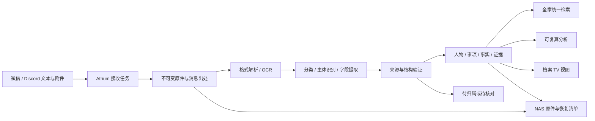

# Atrium 家庭 AgentOS：智能综合档案设计

日期：2026-10-03，Asia/Singapore。

状态：用户需求与第一阶段优先级已明确；下述架构为待实施设计，不代表当前线上能力。当前在线版本仍为按成员保存结构化记录的实现。

## 产品目标

Atrium 长期演进为家庭 AgentOS。它拥有全家的持久资料、可追溯事实、人物与事项关联、分析和任务状态；OpenClaw 是当前对话与 Agent 接入层，电视是家庭展示入口。

用户直接通过微信、Discord 提供文本、图片或文件，系统自动识别内容、人物、类别和时间，保存原件，提取数据，关联历史，再给出归档回执和可核查的分析。不能要求用户事先登记全家名单、预建目录或先手选分类。

用户已选择第一阶段优先“全家综合档案”：健康、教育、财务、房屋资料统一检索。健康专题分析不是第一阶段唯一目标。

沿用已有授权：家庭记录默认允许 TV 展示，明确要求私密的条目除外。改变归属、合并档案、处理来源不明的文件不得借此推导其他权限。

## 当前能力与实际缺口

- 已有 Go Core、SQLite、NAS 结构化记录归档、React TV、OpenClaw/DeepSeek 和受控 MCP。
- 当前成员模型仅有 ID、名字，生产配置只建立并授权阿布；成员创建为管理员入口。
- 当前记录必须指定 member_id，类别固定为成长、健康、体检、饮食、生活；日期是必填时间点。该模型不适合未知人物、多人物、家庭共有资料或只有月份的文件。
- 已有记录修订、撤回、NAS 导出和 IM 原始消息去重，需保留。
- 当前接口没有档案原件、逐页文本、附件证据、自动人物匹配、综合检索或分析快照。
- 当前 OpenClaw 未配置专门 imageModel。不能仅因微信能下载图片就宣称 OCR、表格提取或所有格式已经可用；解析方案要单独验收。
- 微信 SenderId 漏传已修复，用户确认查询恢复；原件接入仍需独立验证。

## 路线选择

1. 推荐：Atrium 原件与事实库＋OpenClaw 理解编排。Core 管理持久身份、存储、任务和证据，模型输出结构化提取建议，由 Core 验证提交。接入层和模型可替换，原档案及索引不依附聊天历史。
2. 仅扩充 OpenClaw 提示词与记忆：建设快，但缺少附件持久保存、稳定身份、修订追溯和统一检索，不满足目标。
3. 立即自建完整多 Agent 平台：自由度高，但会重复当前运行时；推迟真实档案接入。后续按家庭能力增量扩展，不作为第一阶段前置工程。

## 用户体验

正常情况无需预先配置，例如发送一张完整体检报告，系统从“受检人”字段识别档案主体，从报告内容判断类型，提取检查日期和指标，关联同一人的既往报告。不能将医生、签字人、付款人或消息发送者直接当成受检人。

归档回执表达实际状态，例如“已保存原件；识别为某人的体检报告；提取 18 项指标；已关联 2 份历史报告”。只有 NAS 读回成功才说“已同步 NAS”；只有提取成功才报指标数。

新人物有明确主体姓名时自动建立独立人物档案，无需维护者先建成员；家庭关系可为空。新人物不自动获得账户权限，也不因姓名出现而认定其是家人。家庭成员关系与档案主体身份分开保存。

遇到同名冲突、无法辨认姓名或“妈妈”等称呼没有明确参照时，先保存原件和能确定的信息，再提出一个针对归属的问题。待归属档案可检索，但不混进任何人的统计。不得凭文件名、发送者身份或模型自报置信度强行合并。

一份家庭保单可关联投保人、被保人、受益人；房产资料可关联房屋、产权人；学校通知可属于全家或教育事项，不强制选一个人。

## 数据流

慢任务离开现有 30 秒 Brain turn，存为可恢复后台作业；IM 可以先确认已接收。第一阶段通过查询任务状态获取结果，不因新建任务而自动增加主动通知、日程或外发。

## 数据模型

原件、事实、模型推断分别保存，不把一段模型总结当成事实库。

| 实体 | 内容 |
| --- | --- |
| archive_sources | 渠道、账户作用域、原始消息 ID、附件序号、接收时间；不对 TV 暴露账号标识 |
| archive_documents | 文件哈希、真实 MIME、原名、大小、原件引用、解析状态、保存及 NAS 状态 |
| archive_extractions | 文档版本、解析器/模型版本、文本块与页码、字段及其来源坐标、警告 |
| archive_entities | 人物、房屋、家庭共有事项等稳定实体；主体名、可空关系，不等同账户身份 |
| archive_aliases | 已有证据支持的别名及来源；同名候选可以并存 |
| archive_links | 文档—主体—角色多对多关系，例如受检人、产权人、被保人 |
| archive_facts | 原始字段名和值、可选规范字段和值、单位、时间精度、来源块、当前修订状态 |
| archive_jobs | 持久任务、阶段、重试次数、租约、错误原因、幂等键 |
| archive_analyses | 参与计算的事实版本、覆盖范围、算法版本、结果、生成时间和失效状态 |

日期支持 date、month、year、datetime、unknown，不以接收日或模型猜测补出报告日期。金额保留币种，计量保留原单位，规范化值与转换规则另存。

原件按内容哈希存储；同文件从两个渠道重复发送只复用原件，保留两条来源关联。相同文字但不同真实事件不能仅凭正文哈希去重。重新 OCR 不新增一次体检或支出。

分类采用“领域＋文档类型＋可扩展标签”，同一份资料可多标签。第一阶段领域为健康、教育、财务、房屋、生活、其他；类型可新增，例如体检报告、成绩单、保单、收据、合同、维修单。未知类型仍可保存和检索，不默认为喂养或阿布的记录。

## 人物识别与修订规则

1. 先提取主体角色及其原文证据，而不是收集所有人名后任选一个。
2. 搜索现有实体、别名与已确认关系；有一致的明确身份信息时自动关联。
3. 无现有人物且主体证据清楚：建立独立实体并归档，不猜关系、生日或性别。
4. 同名、别名冲突、缺少主体：保留候选，进入待归属；提问不能阻塞其他文件处理。
5. 人物合并必须可撤销、保留原 ID 和迁移历史；不能依赖模型一次判断进行不可逆合并。
6. 用户纠正“这是另一个人的报告”时，修订关联并使相关分析过期，原件与旧关联历史保留。

主体证据充分与不足由可检查规则和来源支持，不直接使用模型随口给出的概率作为自动合并阈值。

## 多格式边界

接收与可理解是两个能力，界面必须分别表达。

| 输入 | 第一阶段计划 |
| --- | --- |
| 聊天文本、TXT、Markdown | 保存原文并结构化提取 |
| JPEG、PNG、WebP | 保存原图，OCR/版面解析，字段关联图像区域 |
| PDF | 原件保存；有文本层直接提取，扫描页进入 OCR；逐页保留证据 |
| DOCX | 提取段落和表格，保留原件与段落/表格定位 |
| XLSX、CSV | 保留工作表、行列、原始显示值；不执行公式或宏 |
| HEIC、旧 Office、加密文件、压缩包及其他格式 | 检测真实格式并保存支持的原件，明确“待解析/暂不支持”；不能伪造解析成功 |

附件经可信渠道适配器取得，Core 接收有界字节流和宿主签发的附件引用。模型不能指定任意本机路径或下载地址。文件中的文字是待处理资料，不是修改权限或调用工具的指令。

首期解析器采用可替换接口。优先评估本机文本提取与 macOS OCR，以已有 DeepSeek 对提取文本做分类。选用专门视觉服务前需确认真实模型能力、部署配置和测试样本；不更换用户的主模型、不编造现有图片识别能力。

## 统一检索和分析

首先提供全文索引、人物/领域/类型/日期筛选、来源片段和档案详情。自然语言查询转成受控检索条件，可用已有别名扩展；无需先引入向量库。语义检索是否需要，由混合档案查询集的召回结果决定。

示例查询：“找全家最近一年的体检报告”“这套房子的保修资料在哪”“孩子这学期的成绩单”“今年记录了哪些家庭支出”。没有全量账单时只能描述已归档数据的统计，不能声称家庭全部支出。

可确定计算用代码完成，包括条数、金额合计、日期排序、同比/历史差值、按人或类别汇总。模型负责解释和关联，不凭印象算总数。

健康指标比较保留检验项目、单位、报告参考范围、样本/检查时间；不同单位或项目不可直接相加或拼成一条趋势。教育指标保留科目、满分及学期；财务区分币种、收入/支出、账单与付款凭证；房屋记录按地址实体、设备和事件关联。自动识别不等于自动作出诊断、财务决策或执行家庭事务。

每个结论提供所依据的档案/页码或文本段、数据覆盖时间和缺失项。原始事实更新、撤回或归属纠正后使相关结果失效并重新计算。

## TV 展示

顶部保持“档案”。档案首页提供全家视图与搜索入口，按人物、领域、时间浏览；未归属和处理中的文件有独立入口。人物页展示该人的跨领域资料和时间线，房屋等共有实体可独立查看。

已授权展示的记录默认显示；私密覆盖优先。先展示摘要与有来源的数据，原件预览通过授权入口加载，不把 NAS 路径直接暴露给客户端。延续现有纸色、宋式字体、圆润图标和遥控交互。

## 与现有数据兼容

保留 family_records 及其修订链，阿布和现有六条有效喂养记录继续可读。将旧记录以明确 legacy 来源关联到新档案视图，不伪造缺失原件、来源页码或真实发送人信息。

不把现有 `member_ids` 白名单改成通配符。新档案 API 使用明确的家庭作用域以及独立的档案读取、接收和整理能力；自动建立主体实体不自动扩张旧集成的管理员权限。授权策略的部署迁移必须明确且可回退。

NAS 原件存储与现有只读照片目录隔离。先在本机持久保存并入队，NAS 暂不可用时显示待同步。恢复清单包含实体、关联、原件哈希、提取结果和版本，不能只恢复 JSON 摘要而丢失原文件。

## 第一阶段交付顺序

1. 接收与原件：持久任务、可信附件传递、文本及文件保存、重复投递和 NAS 队列。
2. 理解与归属：解析文本/图片/PDF/Office，主体角色识别、自动建立实体、分类和待归属。
3. 综合检索：原文索引、跨人物及领域查询、证据定位、修订反馈。
4. 档案界面：全家入口、人物/房屋/类别视图、处理状态、原件预览、保留旧喂养记录。
5. 基础分析：按已归档数据计算汇总、历史比较和时间线；健康专题进一步分析随后扩展。

以上五步一起构成第一阶段目标；只增加几个数据库字段或改提示词不算智能档案管理交付。Agent 主动任务、日程提醒、家庭设备联动、多 Agent 协作属于后续阶段，需各自明确触发和执行范围。

## 验收场景

- 未预建人物时输入两个人的报告，分别建立档案；报告中的医生不得变成受检人。
- 单份多页 PDF 涉及多人，原件只存一份，按页与主体关联；跨页字段不串人。
- 同名冲突保留待归属，普通归档自动完成；修正归属后统计随之更新。
- 同一附件经微信、Discord 重发以及网关重启重投，不重复计算报告/支出；来源均保留。
- 照片、文本 PDF、扫描 PDF、DOCX 表格、XLSX/CSV 均有独立真实解析证据；不支持或加密文件明确报状态。
- 全家健康、教育、财务、房屋混合样本可用自然语言检索，结果定位到原件，未检索到不等于“从未发生”。
- 模型不可用时接收已持久保存的文件仍可查询状态；恢复后作业可继续，不重复提交事实。
- NAS 断开、任务中断、图片不清楚都不丢原件；恢复到新目录后原件哈希与事实关联完整。
- TV 实机验证全家与个人视图；已有喂养记录、私密覆盖、撤回历史继续正常。
- 端到端以用户真实 IM 附件做最终验证；自动测试使用合成样本，不向生产写入假家庭资料。

## 后续实现落点

新增 domain/archive、store/archive 及迁移、archive 接收/处理/检索服务、受控集成 API 和 MCP 工具。扩展 `internal/brain/model_tools.go`、执行与账本契约以及 `adapters/openclaw`，让长任务独立于一次模型 turn，保留受控工具边界。TV 从 `web/src/screens/FamilyScreen.tsx` 演进，旧 family 路由与记录接口保持兼容。

实现前逐项写红灯测试；阶段完成时验证原件保存、解析、归属、查询、NAS 和实屏，而不只验证模型给出的文字答复。每项以实际已验证格式和链路报告状态。
