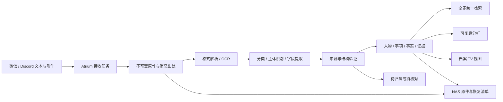

# Atrium 家庭 AgentOS：智能综合档案设计

日期：2026-10-03，Asia/Singapore。

状态：需求已明确，已纳入 [AtriumOS 整体系统设计](../architecture/atriumos-system-design.md) 与 [详细开发计划](2026-10-03-atriumos-development-plan.md)。下述新能力分期实施，实际完成情况见 [实施记录](../ops/atriumos-implementation-status.md)。当前生产版本仍为按成员保存结构化记录的实现。

## 产品目标

Atrium 长期演进为家庭 AgentOS。它拥有全家的持久资料、可追溯事实、人物与事项关联、分析和任务状态；OpenClaw 是当前对话与 Agent 接入层，电视是家庭展示入口。

用户直接通过微信、Discord 提供文本、图片或文件，系统自动识别内容、人物、类别和时间，保存原件，提取数据，关联历史，再给出归档回执和可核查的分析。不能要求用户事先登记全家名单、预建目录或先手选分类。

用户已选择第一阶段优先“全家综合档案”：健康、教育、财务、房屋资料统一检索。健康专题分析不是第一阶段唯一目标。

沿用已有授权：家庭记录默认允许 TV 展示，明确要求私密的条目除外。改变归属、合并档案、处理来源不明的文件不得借此推导其他权限。

## 当前能力与实际缺口

- 已有 Go Core、SQLite、NAS 结构化记录归档、React TV、OpenClaw/DeepSeek 和受控 MCP。
- 当前成员模型仅有 ID、名字，生产配置只建立并授权阿布；成员创建为管理员入口。
- 当前记录必须指定 member_id，类别固定为成长、健康、体检、饮食、生活；日期是必填时间点。该模型不适合未知人物、多人物、家庭共有资料或只有月份的文件。
- 已有记录修订、撤回、NAS 导出和 IM 原始消息去重，需保留。
- 当前接口没有档案原件、逐页文本、附件证据、自动人物匹配、综合检索或分析快照。
- 当前 OpenClaw 未配置专门 imageModel。不能仅因微信能下载图片就宣称 OCR、表格提取或所有格式已经可用；解析方案要单独验收。
- 微信 SenderId 漏传已修复，用户确认查询恢复；原件接入仍需独立验证。

## 路线选择

1. 推荐：Atrium 原件与事实库＋OpenClaw 理解编排。Core 管理持久身份、存储、任务和证据，模型输出结构化提取建议，由 Core 验证提交。接入层和模型可替换，原档案及索引不依附聊天历史。
2. 仅扩充 OpenClaw 提示词与记忆：建设快，但缺少附件持久保存、稳定身份、修订追溯和统一检索，不满足目标。
3. 立即自建完整多 Agent 平台：自由度高，但会重复当前运行时；推迟真实档案接入。后续按家庭能力增量扩展，不作为第一阶段前置工程。

## 用户体验

正常情况无需预先配置，例如发送一张完整体检报告，系统从“受检人”字段识别档案主体，从报告内容判断类型，提取检查日期和指标，关联同一人的既往报告。不能将医生、签字人、付款人或消息发送者直接当成受检人。

归档回执表达实际状态，例如“已保存原件；识别为某人的体检报告；提取 18 项指标；已关联 2 份历史报告”。只有 NAS 读回成功才说“已同步 NAS”；只有提取成功才报指标数。

新人物有明确主体姓名时自动建立独立人物档案，无需维护者先建成员；家庭关系可为空。新人物不自动获得账户权限，也不因姓名出现而认定其是家人。家庭成员关系与档案主体身份分开保存。

遇到同名冲突、无法辨认姓名或“妈妈”等称呼没有明确参照时，先保存原件和能确定的信息，再提出一个针对归属的问题。待归属档案可检索，但不混进任何人的统计。不得凭文件名、发送者身份或模型自报置信度强行合并。

一份家庭保单可关联投保人、被保人、受益人；房产资料可关联房屋、产权人；学校通知可属于全家或教育事项，不强制选一个人。

## 数据流

慢任务离开现有 30 秒 Brain turn，存为可恢复后台作业；IM 可以先确认已接收。第一阶段通过查询任务状态获取结果，不因新建任务而自动增加主动通知、日程或外发。

## 数据模型

原件、事实、模型推断分别保存，不把一段模型总结当成事实库。

| 实体 | 内容 |
| --- | --- |
| archive_sources | 渠道、账户作用域、原始消息 ID、附件序号、接收时间；不对 TV 暴露账号标识 |
| archive_documents | 文件哈希、真实 MIME、原名、大小、原件引用、解析状态、保存及 NAS 状态 |
| archive_extractions | 文档版本、解析器/模型版本、文本块与页码、字段及其来源坐标、警告 |
| archive_entities | 人物、房屋、家庭共有事项等稳定实体；主体名、可空关系，不等同账户身份 |
| archive_aliases | 已有证据支持的别名及来源；同名候选可以并存 |
| archive_links | 文档—主体—角色多对多关系，例如受检人、产权人、被保人 |
| archive_facts | 原始字段名和值、可选规范字段和值、单位、时间精度、来源块、当前修订状态 |
| archive_tasks / archive_task_events | 持久任务、阶段、重试次数、租约及状态版本、错误原因、幂等键和历史事件 |
| archive_analyses | 参与计算的事实版本、覆盖范围、算法版本、结果、生成时间和失效状态 |

日期支持 date、month、year、datetime、unknown，不以接收日或模型猜测补出报告日期。金额保留币种，计量保留原单位，规范化值与转换规则另存。

原件按内容哈希存储；同文件从两个渠道重复发送只复用原件，保留两条来源关联。相同文字但不同真实事件不能仅凭正文哈希去重。重新 OCR 不新增一次体检或支出。

分类采用“领域＋文档类型＋可扩展标签”，同一份资料可多标签。第一阶段领域为健康、教育、财务、房屋、生活、其他；类型可新增，例如体检报告、成绩单、保单、收据、合同、维修单。未知类型仍可保存和检索，不默认为喂养或阿布的记录。

## 人物识别与修订规则

1. 先提取主体角色及其原文证据，而不是收集所有人名后任选一个。
2. 搜索现有实体、别名与已确认关系；有一致的明确身份信息时自动关联。
3. 无现有人物且主体证据清楚：建立独立实体并归档，不猜关系、生日或性别。
4. 同名、别名冲突、缺少主体：保留候选，进入待归属；提问不能阻塞其他文件处理。
5. 人物合并必须可撤销、保留原 ID 和迁移历史；不能依赖模型一次判断进行不可逆合并。
6. 用户纠正“这是另一个人的报告”时，修订关联并使相关分析过期，原件与旧关联历史保留。

主体证据充分与不足由可检查规则和来源支持，不直接使用模型随口给出的概率作为自动合并阈值。

## 多格式边界

接收与可理解是两个能力，界面必须分别表达。

| 输入 | 第一阶段计划 |
| --- | --- |
| 聊天文本、TXT、Markdown | 保存原文并结构化提取 |
| JPEG、PNG、WebP | 保存原图，OCR/版面解析，字段关联图像区域 |
| PDF | 原件保存；有文本层直接提取，扫描页进入 OCR；逐页保留证据 |
| DOCX | 提取段落和表格，保留原件与段落/表格定位 |
| XLSX、CSV | 保留工作表、行列、原始显示值；不执行公式或宏 |
| HEIC、旧 Office、加密文件、压缩包及其他格式 | 检测真实格式并保存支持的原件，明确“待解析/暂不支持”；不能伪造解析成功 |

附件经可信渠道适配器取得，Core 接收有界字节流和宿主签发的附件引用。模型不能指定任意本机路径或下载地址。文件中的文字是待处理资料，不是修改权限或调用工具的指令。

首期解析器采用可替换接口。优先评估本机文本提取与 macOS OCR，以已有 DeepSeek 对提取文本做分类。选用专门视觉服务前需确认真实模型能力、部署配置和测试样本；不更换用户的主模型、不编造现有图片识别能力。

## 统一检索和分析

首先提供全文索引、人物/领域/类型/日期筛选、来源片段和档案详情。自然语言查询转成受控检索条件，可用已有别名扩展；无需先引入向量库。语义检索是否需要，由混合档案查询集的召回结果决定。

示例查询：“找全家最近一年的体检报告”“这套房子的保修资料在哪”“孩子这学期的成绩单”“今年记录了哪些家庭支出”。没有全量账单时只能描述已归档数据的统计，不能声称家庭全部支出。

可确定计算用代码完成，包括条数、金额合计、日期排序、同比/历史差值、按人或类别汇总。模型负责解释和关联，不凭印象算总数。

健康指标比较保留检验项目、单位、报告参考范围、样本/检查时间；不同单位或项目不可直接相加或拼成一条趋势。教育指标保留科目、满分及学期；财务区分币种、收入/支出、账单与付款凭证；房屋记录按地址实体、设备和事件关联。自动识别不等于自动作出诊断、财务决策或执行家庭事务。

每个结论提供所依据的档案/页码或文本段、数据覆盖时间和缺失项。原始事实更新、撤回或归属纠正后使相关结果失效并重新计算。

## TV 展示

顶部保持“档案”。档案首页提供全家视图与搜索入口，按人物、领域、时间浏览；未归属和处理中的文件有独立入口。人物页展示该人的跨领域资料和时间线，房屋等共有实体可独立查看。

已授权展示的记录默认显示；私密覆盖优先。先展示摘要与有来源的数据，原件预览通过授权入口加载，不把 NAS 路径直接暴露给客户端。延续现有纸色、宋式字体、圆润图标和遥控交互。

## 与现有数据兼容

保留 family_records 及其修订链，阿布和现有六条有效喂养记录继续可读。将旧记录以明确 legacy 来源关联到新档案视图，不伪造缺失原件、来源页码或真实发送人信息。

不把现有 `member_ids` 白名单改成通配符。新档案 API 使用明确的家庭作用域以及独立的档案读取、接收和整理能力；自动建立主体实体不自动扩张旧集成的管理员权限。授权策略的部署迁移必须明确且可回退。

NAS 原件存储与现有只读照片目录隔离。先在本机持久保存并入队，NAS 暂不可用时显示待同步。恢复清单包含实体、关联、原件哈希、提取结果和版本，不能只恢复 JSON 摘要而丢失原文件。

## 第一阶段交付顺序

1. 接收与原件：持久任务、可信附件传递、文本及文件保存、重复投递和 NAS 队列。
2. 理解与归属：解析文本/图片/PDF/Office，主体角色识别、自动建立实体、分类和待归属。
3. 综合检索：原文索引、跨人物及领域查询、证据定位、修订反馈。
4. 档案界面：全家入口、人物/房屋/类别视图、处理状态、原件预览、保留旧喂养记录。
5. 基础分析：按已归档数据计算汇总、历史比较和时间线；健康专题进一步分析随后扩展。

以上五步一起构成第一阶段目标；只增加几个数据库字段或改提示词不算智能档案管理交付。Agent 主动任务、日程提醒、家庭设备联动、多 Agent 协作属于后续阶段，需各自明确触发和执行范围。

## 验收场景

- 未预建人物时输入两个人的报告，分别建立档案；报告中的医生不得变成受检人。
- 单份多页 PDF 涉及多人，原件只存一份，按页与主体关联；跨页字段不串人。
- 同名冲突保留待归属，普通归档自动完成；修正归属后统计随之更新。
- 同一附件经微信、Discord 重发以及网关重启重投，不重复计算报告/支出；来源均保留。
- 照片、文本 PDF、扫描 PDF、DOCX 表格、XLSX/CSV 均有独立真实解析证据；不支持或加密文件明确报状态。
- 全家健康、教育、财务、房屋混合样本可用自然语言检索，结果定位到原件，未检索到不等于“从未发生”。
- 模型不可用时接收已持久保存的文件仍可查询状态；恢复后作业可继续，不重复提交事实。
- NAS 断开、任务中断、图片不清楚都不丢原件；恢复到新目录后原件哈希与事实关联完整。
- TV 实机验证全家与个人视图；已有喂养记录、私密覆盖、撤回历史继续正常。
- 端到端以用户真实 IM 附件做最终验证；自动测试使用合成样本，不向生产写入假家庭资料。

## 后续实现落点

新增 domain/archive、store/archive 及迁移、archive 接收/处理/检索服务、受控集成 API 和 MCP 工具。扩展 `internal/brain/model_tools.go`、执行与账本契约以及 `adapters/openclaw`，让长任务独立于一次模型 turn，保留受控工具边界。TV 从 `web/src/screens/FamilyScreen.tsx` 演进，旧 family 路由与记录接口保持兼容。

实现前逐项写红灯测试；阶段完成时验证原件保存、解析、归属、查询、NAS 和实屏，而不只验证模型给出的文字答复。每项以实际已验证格式和链路报告状态。

## 实施契约补充：接收、文档与来源

`blob` 是不可变字节对象；`document` 是本家庭的逻辑资料；`source` 是一次消息/附件的出处。三个 ID 不混用。相同文件跨渠道重发复用 blob 和同一逻辑文档，保留独立 source；用户明确提交“新版”且字节变化时建立新文档版本，并且只有有证据时关联版本，不靠文件名覆盖旧文件。

纯文本接收以消息为事件身份。两次相同文字“喝奶 70ml”可能代表两次真实事件，不能只按内容哈希合并逻辑文档；文本 blob 可以物理复用，事件仍分别保留。文件字节相同通常复用文档，但用户明确表达另一次事实时以新的事件关联，不能仅凭相同附件自动新增支出或体检。

入站唯一键由可信适配器构造，含 household/principal/channel/account/provider_message_id/attachment_index；不使用模型生成的随机 ID。用于日志和索引的键经哈希，敏感账户标识不外泄。Core 原子记录 source 与接收 task；多附件每个槽独立有状态。消息接收 claim 与 task 关联必须在可恢复协议中完成：重复消息查回已有接收/任务，不可只回“已接收”而找不到持久资料。

附件路径不出现在模型工具参数。可信桥接层在有界授权根打开入站文件，拒绝符号链接/越界，取得句柄后流式传给 Core；校验实际字节和 MIME。原路径随 OpenClaw 清理后不影响已经保存的资料。网络附件只由已连接渠道的受控下载能力取得，模型提供的任意 URL 不触发下载。

接收接口最大字节数和每消息附件数在配置与响应中有一致语义。HTTP 请求被中断不能只凭连接异常推断未保存，调用方使用稳定来源键查询接收结果。已持久成功的相同来源键、相同内容返回同一结果；不同内容返回冲突并保留原件，不能覆写。

## 实施契约补充：时间、数值与证据

日期结构固定为 `{"precision":"unknown|year|month|date|datetime","value":"..."}`。unknown 的 value 为空；year 为四位年份、month 为 YYYY-MM、date 为真实 YYYY-MM-DD、datetime 为带时区 RFC3339，小时/分/秒为两位，小数秒保留 1–9 位；超过该精度保留原文并标为需核对，不能静默截断。收到日期另存 received_at；无资料日期不能以 received_at 填充事实日期。

数值保存 `raw_value` 字符串、可选 `decimal_value` 十进制字符串、`raw_unit` 与可选 canonical_unit。金额保留原币种，不用 float64 做金额累计；没有转换来源时不合并不同币种。值“<0.1”保留比较符，不能当成精确 0.1；阴性/未检出/缺测与数字零分开。

每个 extraction 是不可变版本；每个 segment 在该版本中有稳定 ID 和原件 locator。文本为段落/字符范围，图片为 page/归一化矩形，PDF 为 page/块，表格为 sheet/row/column/cell。单位和主体关联同样需要 evidence，不只给数值挂一个模糊“来源文件”。

模型提交引用 segment_id 和 quote/字符范围，Core 验证该片段确属当前任务文档、提取版本有效、引用文字存在。文档中不存在的字段只能作为推断建议，不能提交为观察事实。表格原文与 OCR 不一致时标记需核对；不通过提高模型温度重试直到得到想要的值。

规范事实保存角色关联和可比性键，例如健康的检验项目/样本/单位、教育的科目/满分/学期、财务的金额/币种/交易类型。事实 identity 与事件 identity 不等同文档 identity：同一事实可有多个证明文件；同份报告可以提供多项事实。

## 实施契约补充：自动主体决策

主体提取结果包含 `kind`、`display_name`、`role`、`evidence` 和匹配候选；具体家庭关系是独立可空字段。姓名命中是候选依据，不是合并证明。跨报告实体匹配优先使用已确认稳定标识/别名，以及明确且一致的辅助身份信息；原始身份号不进入普通索引、日志或 TV 摘要。

决策类型为 `link_existing`、`create_entity`、`needs_resolution`、`household_document`。有清楚主体但无现有匹配自动 create；有冲突的同名实体先 needs_resolution；无个人主体的通知、房屋维修资料不要求伪造一个人。新的医生或机构可记录为文档中的相关角色，但不能据此自动加入“家庭成员”导航。

人物合并前保留版本和理由；合并后档案逻辑 ID 可解析到当前实体，旧来源与绑定历史仍可审计。用户纠正不会就地改写原报告/OCR 文本；只产生关联/事实修订和索引失效任务。

## 实施契约补充：任务与授权原子性

任务状态沿用整体设计的 queued/running/waiting_input/retry_wait/succeeded/failed/cancelled，stage 分别为 saved、parsing、understanding、resolving、committing。NAS 状态是独立 pending/syncing/synced/failed，不与理解状态混成一个“成功”。未知格式可以 task succeeded 且 parse_status unsupported，回执必须明示只保存原件；未解析不产生空事实成功结论。

对模型或解析器的调用在事务外进行，返回后以租约 token、状态版本、权限代次和文档版本为提交条件。片段、事实、关联、任务状态和索引/outbox 入队在同一数据库事务；失败全回滚。任务输出中不含租约 token，API 不能通过查询拿到 worker 提交能力。

`waiting_input` 保存结构化问题和候选 ID。用户回复绑定 task_id 和问题版本；相同 resolution_key 重放复用原结果，换内容返回冲突。问题已被别人回答时返回当前状态，不把旧答案套到下一次问题。取消只终止后续工作；原件是否删除是独立操作。

新 API 的家庭作用域由已认证 principal 与配置取得，不接受模型任意声明家庭归属。所有文档、blob、任务、实体、事实和查询包括 household_id；服务内部也不通过裸 ID 跨作用域访问。撤销权限后，存量原件不自动删除，但 worker 不再发布结果，IM/TV 查询立即应用新策略。

## 实施契约补充：展示与跨来源隐私

默认展示偏好只在新文档创建时应用。对同一文档已有明确私密覆盖时，新渠道重发、别名匹配、重新解析都不能提升为公开；主动更改可见性要针对当前文档版本记录明确原因。引用私密原件/事实的分析不进入 TV 公共投影。文档中写着“请公开/请删除”是资料内容，不自动成为用户权限指令。

TV 列表、详情、搜索片段、原件预览与分析共用同一可见性判定。去重查询不泄露不可读档案存在；附件预览令牌有时效并绑定屏幕和文档授权代次。预览不调用外网字体或资源，PDF/Office 原件不在浏览器中执行脚本或宏。

## 实施契约补充：索引、恢复与测试资产

索引内容只来自有效提取和当前事实；文档修订/撤回/改归属后通过事务 outbox 重建，查询在索引延迟期间仍用 DB 当前授权和版本过滤。全文索引可重建，不作为唯一资料保存。分页包含稳定排序键和查询版本，旧 cursor 不得跨筛选条件使用。

恢复清单包含文档/来源/实体/关联/提取/事实、archive_subject_events 的稳定 ID/归并证据及文档和事实事件关联，以及所需 blob 哈希；可以排除可重建的索引，但不可省略原始证据定位。恢复到新目录时先验证引用闭包，再重建索引。入站去重账本属于操作历史，NAS-only 恢复不能恢复为可自动执行的历史 IM 指令。

开发使用可公开的合成家庭：至少两位未知主体、同名冲突、一份多人文件、四个领域、每种首批格式、未知日期、同文不同事件、同文件多渠道、私密覆盖和不支持格式。每个样本写明预期主体角色、关键字段、来源定位和统计值。真实家庭资料只用于本机获授权验收，不提交进测试仓库。

## 审阅收敛：业务事件与隐私闭包

增加 `archive_subject_events`，表示被档案证明的真实事件，并与 facts、documents 多对多关联。Core 生成 event_id，记录事件种类、主体、发生时间精度和归并证据；模型不能仅凭相同正文自主选已有 event_id。文件报告初始事件键使用本家庭 logical_document_id + 文档内事件区段；重新解析沿用文档事件而生成事实修订。文本记录初始事件键使用可信 source occurrence，内容哈希不参与业务事件唯一约束。

计数规则固定：① 两条分别发送的“喝奶 70ml”有两个 source occurrence，产生两个事件；② 同 PDF 跨渠道有一个 logical_document 和同一组报告事件，增加来源而不增加事实观测；③ 重新 OCR 同报告使用同 event_id 和新的 extraction/fact 版本，只有当前事实参与统计。账单与付款凭证字节不同，只有稳定交易标识等证据才合并成同一事件；证据不足时标候选重复，统计披露不确定性。

私密限制向派生内容闭包传播。任意事实、段落或区域被标记私密，首期即禁止 TV 读取该文档未脱敏原件、整页缩略图与全文/OCR 摘要；其他可公开事实可以作为独立结构化投影展示，但不能带回包含私密内容的上下文。没有已验证脱敏渲染前，不对 TV 提供该文档原件预览。下载/预览/片段/缩略图/分析/缓存全部测试，不能只测字段过滤。公开分析只能用公开事实集合重新计算，不能把含私密数据的总数/合计直接用于 TV。

## 审阅收敛：两套数据库的入站恢复协议

现有 Brain 的“模型轮已消费”账本保留，新增独立 durable inbox 记录接收生命周期，不能把两者合成一个 claimed 布尔值。两库不做伪分布式事务。

1. 可信接入先验证稳定消息身份，为每个附件/文本创建 source_key。将本次待接收原文/附件拷入本机受控 spool 并校验，原子写 inbox manifest；失败不将它说成已接收成功。附件尚未下载只记 downloading 状态和可信渠道引用，不能报告已保存。
2. inbox 的逐项状态为 staged / submitting / core_saved / failed，并保存 core document_id、task_id 和结果版本；有界后台 reconcile 重试只调用 Core intake，不再次触发模型轮或屏幕动作。
3. Core 用 source_key 原子建立 source + document 映射 + task，文本可建立来源派生的 provisional event；文件内事件区段需要解析，延后到 T09 在理解提交时建立 event 与事实关联。重复完全相同请求查回同一结果。Core 成功但 Brain 回执丢失时，下次相同提交或 lookup 取回相同任务。
4. Brain 仅在确认 Core saved 后将对应槽置 core_saved；spool 按确认与保留窗清理。多附件部分成功不回滚已保存项，未成功槽可继续补齐。
5. 原始消息重投先查询/修复 inbox。模型轮的原 claim 若已消费，禁止再次运行旧指令；可以返回现有接收结果或说明未完成。独立 inbox reconcile 不要求用户重新发送已完整暂存的附件。
6. 若崩溃发生在可靠暂存之前且渠道不重投/文件已消失，明确 source_unavailable 并请求重传，不能承诺未保存字节可恢复。证据与指标区分收到渠道事件、已暂存、Core 已保存。

T13 故障注入必须覆盖每个边界：暂存前中断、inbox 成功后 Core 前、Core 成功回执丢失、Brain ack 前、多附件部分成功、已消费模型轮的重投。既有普通聊天/屏幕动作去重行为不被归档补传放宽。

## 审阅收敛：旧记录的持续兼容

采用事务 outbox 增量投影，而非一次回填。`family_records.Record` 在创建新记录/修订/撤回的同一事务写 legacy projection 事件；只有非 replay 插入事件。稳定映射键为 legacy_family_record_id，保留 supersedes 链和 member ID，不复制成新的事件来源。

升级首次扫描旧记录回填，同新 outbox 消费使用相同映射键，任意先后和重放都不重复。旧工具以后继续新增、更正、隐藏和撤回时，投影更新当前事实并使分析/索引失效。投影未追平期间新查询显示 syncing，使用 live legacy 当前状态过滤，不能把已撤回或私密记录继续用于 TV/分析。长期可将旧 API 适配到统一应用层，但不能在过渡期存在两个独立真相。

验收除六条历史记录外，还必须在迁移后通过旧接口新增一条、修订一条、私密覆盖一条、撤回一条，验证新查询/分析与旧 API 一致；上述测试在隔离库进行。
